  <picture>
    <source media="(prefers-color-scheme: dark)" srcset="assets/varda-hero-on-dark.svg">
    <source media="(prefers-color-scheme: light)" srcset="assets/varda-hero-on-light.svg">
    
  </picture>

**Varda** is a free, open-source desktop application for exploring and
analyzing hyperspectral and multispectral images: view a scene in true or
false color, click any pixel for its spectrum, draw regions of interest, and
run analyses from band math and continuum removal to classification, target
detection and an ENVI-style Spectral Hourglass workflow, without writing code.
Plugins add new analyses and file formats.

Developed at the Space Imagery Center, Lunar and Planetary Laboratory,
University of Arizona.

- **[Varda](https://github.com/varda-pro/Varda)**: the source code
- **[Download Varda](https://github.com/varda-pro/Varda/releases/latest)** for Windows, macOS and Linux
- **[User guide](https://github.com/varda-pro/Varda/blob/main/docs/user-guide/README.md)**
- **[Report a bug or suggest a feature](https://github.com/varda-pro/Varda/issues/new/choose)**
